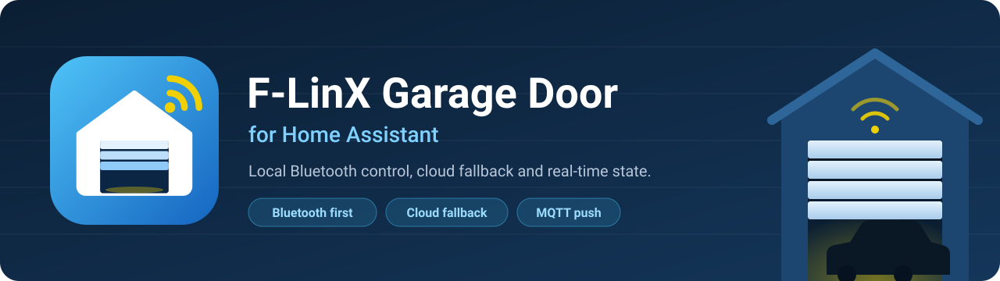
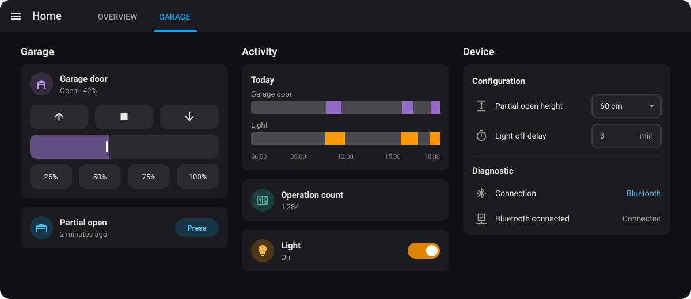
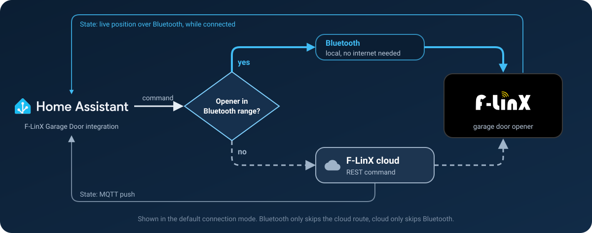
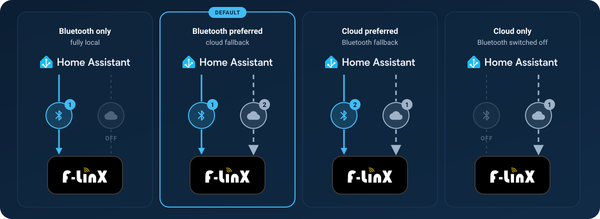

<div align="center">



<br>

[](https://hacs.xyz/)
[](https://github.com/b12e/flinx-garage-ha/releases)
[](https://github.com/b12e/flinx-garage-ha/actions/workflows/validate.yml)
[](LICENSE)


**Control your F-LinX garage door from Home Assistant - locally over Bluetooth, with the cloud as a safety net.**

<sub>WORKS WITH</sub>

<picture><source media="(prefers-color-scheme: dark)" srcset="docs/images/flinx-logo-on-dark.svg"></picture>

[Features](#features) · [How it works](#how-it-works) · [Installation](#installation) · [Connection modes](#connection-modes) · [Dashboard](#dashboard-shortcuts)

</div>

<br>

<p align="center">
  
</p>
<p align="center"><sub>Mock-up of a dashboard built from the entities this integration creates.<br>Shown in the default connection mode: Bluetooth preferred, cloud fallback.</sub></p>

## Features

<table>
  <tr>
    <td width="33%" valign="top">
      
      <h3>Bluetooth first</h3>
      Commands go straight to the opener over Bluetooth, so the door keeps working when the internet doesn't.
    </td>
    <td width="33%" valign="top">
      
      <h3>Configurable connection</h3>
      Bluetooth first with the cloud as fallback by default. Or keep it local with Bluetooth only, or only use the cloud: the choice is yours.
    </td>
    <td width="33%" valign="top">
      
      <h3>Real-time state</h3>
      MQTT push keeps position, light and operation count current, even when the door is moved by a remote or the wall button.
    </td>
  </tr>
  <tr>
    <td valign="top">
      
      <h3>Native partial open</h3>
      A one-tap button that drives the door to its partial open height, where the opener stops by itself.
    </td>
    <td valign="top">
      
      <h3>Any position</h3>
      Drag the slider or call <code>cover.set_cover_position</code> to open the door to any percentage.
    </td>
    <td valign="top">
      
      <h3>Opener settings</h3>
      Change the partial open height (0-160 cm) and the light off delay (1-9 min) right from Home Assistant.
    </td>
  </tr>
</table>

### What you get

| Entity | Type | What it does |
| --- | --- | --- |
|  **Garage Door** | Cover | Open, close, stop and set position |
|  **Partial open** | Button | Native partial open, the same as the app's **Partial** button |
|  **Light** | Light | The opener's LED, on / off |
|  **Operation Count** | Sensor | How many times the door has run |
|  **Partial open height** | Select | 0-160 cm, the same presets as the F-LinX app |
|  **Light off delay** | Number | 1-9 minutes |
|  **Connection** | Sensor (diagnostic) | What the next command goes out over |
|  **Bluetooth connected** | Binary sensor (diagnostic) | On while a Bluetooth link to the opener is up |

One integration entry covers one F-LinX account and all of its connected garage doors. Add or remove garage doors later under **Configure → Manage devices**.

## How it works

<p align="center">
  
</p>

By default, commands are sent via Bluetooth first, falling back to the cloud API automatically when Bluetooth is unavailable. State arrives over MQTT push from the cloud, plus the opener's own position stream while the Bluetooth link is up.

## Installation

### Home Assistant Marketplace (formerly HACS)

[](https://my.home-assistant.io/redirect/hacs_repository/?owner=b12e&repository=flinx-garage-ha&category=integration)

1. Click the button above, or search for **F-LinX Garage Door** in the store, and click **Download**. Follow the on-screen instructions.
2. Go to **Settings → Devices & services → + Add Integration → F-LinX Garage Door**
3. Follow the on-screen instructions

### Configuration

1. Go to **Settings → Devices & Services → Add Integration → F-LinX Garage Door**
2. Enter your F-LinX account credentials
3. Select which doors to add (all doors on your account are pre-selected)

### Requirements

- Home Assistant **2025.2.0** or newer
- A Bluetooth adapter on your HA host (for local commands), or an [ESPHome Bluetooth Proxy](https://esphome.io/components/bluetooth_proxy.html) in range of your garage door
- A garage door that works with the F-LinX app - either directly or via the USB dongle ([F-LinX / Force-Door garage door controller](https://www.myforcedoor.com/prodetails/49/546.html)) (connected to WiFi for cloud control)

## Connection modes

**Configure → Connection mode** decides which connections the integration may use. It applies to every door on the account.

<p align="center">
  
</p>

| Mode | State updates |
| --- | --- |
| **Bluetooth only** | Bluetooth command replies only |
| **Bluetooth preferred, cloud fallback** (default) | MQTT push, cloud poll and Bluetooth |
| **Cloud preferred, Bluetooth fallback** | MQTT push, cloud poll and Bluetooth |
| **Cloud only** | MQTT push and cloud poll |

### Checking which connection is used

Two diagnostic entities show what the integration is doing. They are disabled by default: enable them on the door's device page under **Diagnostic**.

| Entity | Shows |
| --- | --- |
| **Connection** | What the next command goes out over: **Bluetooth**, **Cloud**, or **Not connected** (Bluetooth only, with the link down). Its attributes add the connection mode and what the last confirmed command actually went over. |
| **Bluetooth connected** | On while an authenticated Bluetooth link to the opener is up. |

> [!TIP]
> In **Bluetooth preferred** mode, **Connection** reads **Cloud** exactly when the Bluetooth link is down. If it stays that way, check **Settings → System → Logs** for `BLE unavailable for <door>`, which says why (for example an opener that is out of range or a proxy that is passive-only).

## Native partial open

The **Partial open** button sends the opener's own partial-open command, the same one as the **Partial** button in the F-LinX app. The door drives to the partial open height and stops by itself, so nothing in Home Assistant has to watch the position and send a stop. When the door is already further open, it closes down to that height instead, so it lands there from any position.

The same command is available as an action:

```yaml
action: flinx_garage.partial_open
target:
  entity_id: cover.garage_door
```

### Partial open height and light off delay

Two settings stored in the opener can be changed from Home Assistant, under the device's **Configuration** section:

| Entity | Values | Notes |
| --- | --- | --- |
| **Partial open height** | 0, 2, 4, 8, 12, 20, 40, 60, 80, 100, 120, 140, 160 cm | The heights the F-LinX app offers. Changing it does not move the door. With Home Assistant set to US customary units the options read in inches, with the app's cm alongside (e.g. `24 in (60 cm)`). |
| **Light off delay** | 1-9 minutes | How long the light stays on after the door stops. |

Both are stored on the garage motor, so they are shared with the F-LinX app and with a remote's partial button: whatever you set last, from anywhere, is what the door uses. How far a given height opens your door (as a percentage) depends on the door.

Like commands, settings are written over the connections your connection mode allows - Bluetooth, the cloud, or one with the other as the fallback - and are only shown as changed once the opener confirms them.

## Set position (any percentage)

You can drive the door to a specific percentage with the cover position slider or the `cover.set_cover_position` action. This leaves the partial open height alone.

> [!NOTE]
> This is **best-effort, software-based positioning.** The controller has no native "open to X%" command, so the integration sends a normal open/close and issues a stop once the live position reaches the target. It therefore lands *close* to the requested percentage (typically within a few percent) rather than exactly on it, and the door visibly moves and then stops. `0%` and `100%` use the dedicated close/open commands and reach the hard limits precisely.
>
> This works best over Bluetooth as there is minimal delay in receiving current position updates.

## Dashboard shortcuts

A cover entity has no presets of its own, but the dashboard can put one-tap positions next to it:

- **Partial open:** add the **Partial open** button entity to a card, or use it as a tile card's tap action.
- **Favorite positions:** the tile card's **Cover favorite positions** feature (`type: cover-position-favorite`) shows a list of favorite positions for the cover. Edit them in the cover's **More info** dialog by pressing and holding a favorite. They use set position above, so they work for any percentage and leave the partial open height alone.

```yaml
type: tile
entity: cover.garage_door
features:
  - type: cover-open-close
  - type: cover-position-favorite
```

---

<div align="center">
<sub>
Made by <a href="https://github.com/b12e">@b12e</a> · <a href="https://github.com/b12e/flinx-garage-ha/issues">Report an issue</a> · <a href="CHANGELOG.md">Changelog</a>
<br>
This project is not affiliated with or endorsed by F-LinX or Force-Door.
</sub>
</div>
